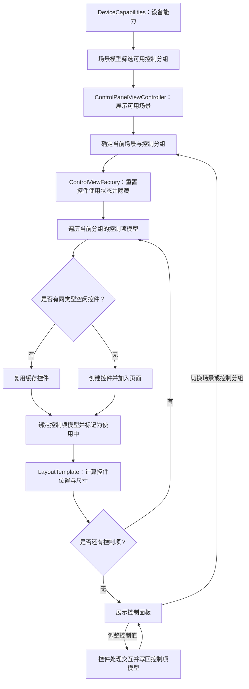

# TemplateFlow

基于 UIKit 的电动控制界面示例，演示“模板流”界面组装方案：将不同控制场景中的重复界面拆分为控制项模型、布局模板和可复用控件，根据设备能力组合生成控制面板。

## 核心特性

- **按设备能力展示功能**：根据设备能力字段筛选可用场景及控制分组，覆盖变焦、切割、遮光板、图案和烟雾五类场景。
- **模板化界面组装**：通过控制分组组合控制项与布局模板，将场景配置和具体布局规则分离，复用纵向排列、单控件填充等布局。
- **统一控件管理**：通过工厂集中创建和复用滑杆、开关、图案选择控件，借鉴 UITableView 的复用思路管理控件使用状态。
- **模型保存编辑状态**：将控制值保存在控制项模型中，用户操作时更新模型，切换场景后重新绑定对应模型。

## 重要组成

- **`ControlModel`**：控制项模型协议，约定控制值 `value` 和控件复用标识 `reuseIdentifier`；各具体模型保存对应控制项的值及参数，供控件读取和编辑。
  - **`SliderControlModel`**：保存滑杆当前值、最小值、最大值和名称，描述变焦、角度、速度等数值控制项。
  - **`SwitchControlModel`**：保存开关状态，以 `1` 表示开启、`0` 表示关闭。
  - **`PatternSelectionModel`**：保存可选图案数量和当前选中的图案索引，索引从 `0` 开始。
- **`LayoutTemplate`**：布局模板协议，约定控件位置和尺寸的计算方法；各具体模板根据控件序号及内容区域，计算并设置控件的布局。
  - **`VerticalLayoutTemplate`**：按序号纵向排列控件，通过 `LayoutMetrics` 指定上边距、左右边距、控件间距和高度，计算每个控件的位置及宽度。
  - **`FillLayoutTemplate`**：将序号为 `0` 的控件铺满内容区域，适用于图案选择等由单个控件承载的面板。
- **`ControlViewFactory`**：提供控件的创建、保管与复用能力，按模型的复用标识分类保存控件；获取时优先使用空闲控件，没有可用控件时再创建，并绑定对应模型。切换分组时统一隐藏控件、标记为空闲，继续保管以供后续复用。

## 模块流程

